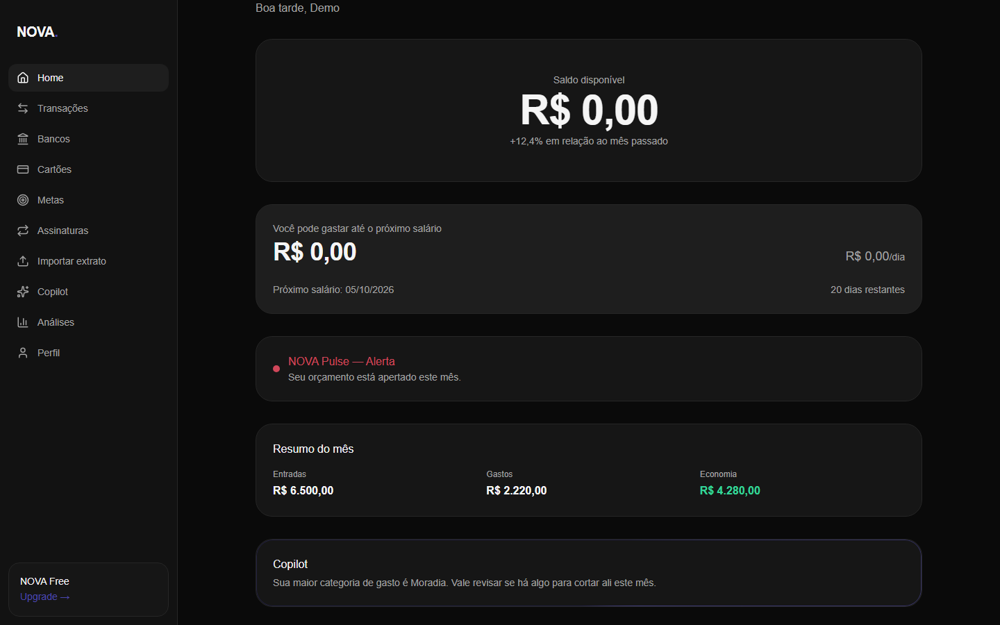

# NOVA

Seu dinheiro. Sob seu controle.

[](https://github.com/paulahaas/nova-finance-app/actions/workflows/ci.yml)
[](LICENSE)

App de finanças pessoais só pra mim: contas, cartões, metas, orçamento e um assistente (Copilot). React + Vite no front, Firebase (login + Firestore) e uma API Express que roda como função da Vercel.



## Rodar

```bash
npm install
cp .env.example .env   # chaves do Firebase e da API do Claude
npm run server         # API local em :8787
npm run dev            # site em :5173 (o Vite manda /api pro servidor)
```

Sem as chaves do Firebase não há login nem dados. Em produção (Vercel) o `api/index.js` serve o mesmo app Express de `server/app.js`.

## O que tem

- **Home e Cartões** no layout novo: cartão 3D que gira, abas por tipo (crédito, débito, os dois). Adicionar cartão pede só um nome; limite, vencimento, fechamento e últimos 4 dígitos são opcionais.
- **Registrar gastos** pelo chat do Copilot, pelo botão (+) da Home (com voz) ou por **foto da nota**. Sempre mostra o que entendeu e pede confirmação. Entende parcelas (`tênis 300 em 3x`), correção (`o uber foi 21`), exclusão (`apaga o último`) e contas fixas (`aluguel 1200 todo dia 5`).
- **Contas fixas**: cadastradas uma vez, lançadas sozinhas todo mês (recupera meses sem abrir o app).
- **Orçamento por categoria**, **faturas** por cartão (estimativa só com o que foi lançado), **alertas**, **fechamento do mês** com sugestões de corte e botão para guardar a sobra na meta.
- **Meta Intercâmbio** em duas fases, comparação de países com câmbio ao vivo, checklist e conquistas.
- **Lembretes no celular** (notificação à noite, 21h, no máximo uma por dia: lembra de anotar os gastos do dia e avisa de orçamento, fatura e conta fixa), ativados em Ajustes.
- Metas, bancos e transações podem ser editados e apagados pela tela. Importação de extrato (CSV/OFX) com categorização própria. Exportação em CSV/Excel e JSON. Instalável no celular (PWA).

O NOVA nunca acessa o banco: quem informa os gastos é o usuário.

## Segurança

App de um usuário só: não existe cadastro, e o `firestore.rules` e a API aceitam apenas o UID do dono (`src/config/owner.js`). Cartão guarda só os últimos 4 dígitos e a validade — número completo e CVV nunca são pedidos.

## Estrutura

`src/pages` por área, `src/contexts` (auth e dados no Firestore), `src/services` (cálculos e importação), `server/` (API: importação de extrato, Copilot, Open Finance).

## Testes

```bash
npm run test
```

Cobre a parte que mais importa acertar sozinha: parser de CSV/OFX, categorização, detecção de duplicata e de recorrência.
